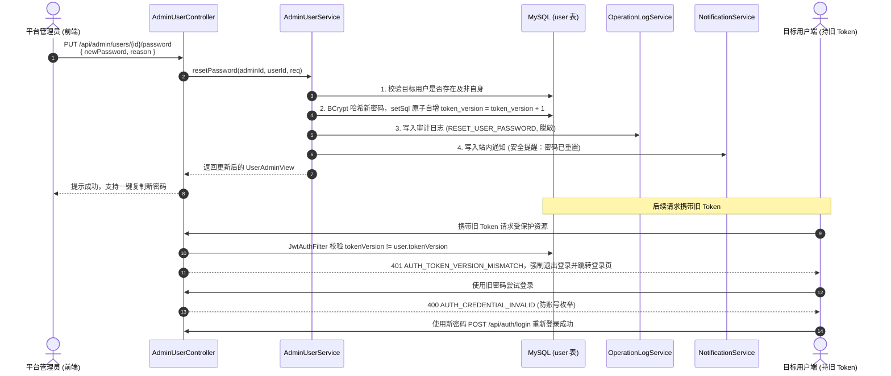

# 管理员重置用户密码功能设计方案

> 文档类型：管理端后台功能与安全设计方案  
> 编制日期：2026-10-17  
> 实施状态：**方案设计，待开发验证**  
> 适用项目：游戏陪玩系统（毕设项目）  
> 设计依据：当前工作区代码、《需求分析说明书》《详细设计说明书》及现存用户体系、JWT认证与审计日志实现  

---

## 1. 设计背景与核心结论

### 1.1 业务背景
在游戏陪玩平台中，普通用户和陪玩师可能由于长期未登录遗忘密码，或因手机号/邮箱变更导致无法通过自主找回密码流程恢复账号；同时，平台运营过程中存在账号异常登录、盗号应急冻结以及人工客服申诉复核等场景。因此，平台管理员需要具备安全、可控地为指定用户重置登录密码的能力。

### 1.2 核心设计结论

| 维度 | 设计方案 | 关键原因 |
|---|---|---|
| **鉴权与会话失效** | 重置密码时自增 `user.token_version` | 利用现有 `JwtAuthFilter`，使得目标用户所有终端原持有的 JWT 令牌立即失效，杜绝“改密后旧会话依然可用”的安全隐患 |
| **密码加密与规则** | 使用 Spring Security `BCryptPasswordEncoder`，统一沿用 `^(?=.*[A-Za-z])(?=.*\\d)\\S{8,32}$` | 保持与注册、自主改密模块相同的复杂度规则（8~32位且含字母与数字），单向散列存储 |
| **操作审计脱敏** | 接入 `OperationLogService` 记录操作日志，**严禁记录任何明文或密文密码** | 符合国家信息安全规范与全局安全协作规则，仅记录操作人、目标ID、操作类型与重置原因 |
| **安全通知** | 接入 `NotificationService` 发送系统通知（`SYSTEM`） | 在目标用户账号中留下安全审计记录，保障用户知情权 |
| **数据表改动** | **无需修改数据库结构（零 DDL 改动）** | 现有 `user` 表具备 `password_hash` 与 `token_version` 字段，可平滑扩展，降低部署与回滚风险 |
| **前端交互** | 手动输入 + 一键生成随机强密码 + 成功后一键复制 | 兼顾运营便利性与密码强壮度，方便管理员将临时凭据安全交付给申诉用户 |

---

## 2. 当前实现基线分析

### 2.1 现有用户数据模型与表结构
在后端实体 `User.java`（对应 MySQL 表 `user`）中，现有与认证和安全相关的关键字段如下：
- `id`: 用户主键 ID
- `username`: 用户唯一登录名
- `password_hash`: BCrypt 哈希加密串
- `token_version`: JWT 令牌版本号（整型）
- `account_status`: 账号状态（`ENABLED` / `DISABLED`）

### 2.2 JWT 令牌版本校验机制
系统的 `JwtAuthFilter` 在拦截每个受保护请求时，会从 JWT Payload 中解析出当前令牌所持有的版本号 `tv`（Token Version），并调用 `AccountAuthService.assertEnabledAndTokenVersion(userId, tokenVersion)`：
```java
if (user.getTokenVersion() == null || user.getTokenVersion() != tokenVersion) {
    throw new BusinessException(ErrorCode.AUTH_TOKEN_VERSION_MISMATCH);
}
```
因此，**只需在修改密码的同时执行 `token_version = token_version + 1`，旧令牌将在下一次 API 调用时被直接拦截并抛出 `AUTH_TOKEN_VERSION_MISMATCH`（HTTP 401），强制前端清理登录态并退登**。

### 2.3 审计与通知机制
- **操作日志**：`OperationLogService.record(...)` 已用于管理端禁用用户、配置修改等操作。
- **站内通知**：`NotificationService.record(...)` 支持异步或轻量写入站内信，异常静默不影响主事务。

---

## 3. 总体架构与处理流程



---

## 4. 接口契约与后端详细设计

### 4.1 REST API 规范
- **请求方式**：`PUT`
- **请求路径**：`/api/admin/users/{id}/password`
- **权限控制**：`@PreAuthorize("hasRole('ADMIN')")`
- **请求头**：`Authorization: Bearer <ADMIN_TOKEN>`

#### 请求体参数
| 字段名 | 类型 | 必填 | 校验规则 | 描述 |
|---|---|---|---|---|
| `newPassword` | String | 是 | `^(?=.*[A-Za-z])(?=.*\\d)\\S{8,32}$` | 8~32位，须同时包含字母和数字 |
| `reason` | String | 否 | 最多 200 字 | 管理员重置原因（用于审计追溯） |

#### 响应体规范
采用统一 `ApiResponse<UserAdminView>` 包装：
```json
{
  "code": "SUCCESS",
  "message": "操作成功",
  "data": {
    "id": 105,
    "username": "player_001",
    "nickname": "绝地枪王",
    "mobile": "13800000000",
    "email": "player@example.com",
    "accountStatus": "ENABLED",
    "roles": ["USER"],
    "createdAt": "2026-08-15T12:00:00"
  }
}
```

### 4.2 DTO 定义 (`UserResetPasswordRequest.java`)
文件位置：`backend/src/main/java/com/gameplay/admin/dto/UserResetPasswordRequest.java`
```java
package com.gameplay.admin.dto;

import jakarta.validation.constraints.NotBlank;
import jakarta.validation.constraints.Pattern;
import jakarta.validation.constraints.Size;
import lombok.Data;

/**
 * 管理端重置用户密码请求 DTO。
 */
@Data
public class UserResetPasswordRequest {

    /**
     * 新密码：8~32 位，必须同时包含字母和数字
     */
    @NotBlank(message = "新密码不能为空")
    @Pattern(regexp = "^(?=.*[A-Za-z])(?=.*\\d)\\S{8,32}$", message = "密码须为 8~32 位且同时包含字母和数字")
    private String newPassword;

    /**
     * 重置原因（记录于操作审计日志）
     */
    @Size(max = 200, message = "重置原因不能超过 200 个字符")
    private String reason;
}
```

### 4.3 控制器扩展 (`AdminUserController.java`)
```java
/**
 * 管理员重置用户密码
 */
@PutMapping("/{id}/password")
public ApiResponse<UserAdminView> resetPassword(@PathVariable Long id,
                                                @Valid @RequestBody UserResetPasswordRequest request,
                                                Authentication authentication) {
    Long adminId = currentAdminId(authentication);
    return ApiResponse.ok(adminUserService.resetPassword(adminId, id, request));
}
```

### 4.4 业务服务层实现 (`AdminUserService.java`)
在 `AdminUserService` 中注入 `PasswordEncoder`、`OperationLogService` 和 `NotificationService`：
```java
@Transactional
public UserAdminView resetPassword(Long adminId, Long userId, UserResetPasswordRequest req) {
    User user = userMapper.selectById(userId);
    if (user == null) {
        throw new BusinessException(ErrorCode.ACCOUNT_NOT_FOUND);
    }
    // 防呆保护：管理员重置自身密码应前往个人中心“修改密码”
    if (adminId != null && adminId.equals(userId)) {
        throw new BusinessException(ErrorCode.VALIDATION_FAILED, "重置自身密码请前往个人中心操作");
    }

    // 1. 更新密码 Hash，并原子自增 token_version 强制旧会话失效
    userMapper.update(null, new LambdaUpdateWrapper<User>()
            .set(User::getPasswordHash, passwordEncoder.encode(req.getNewPassword()))
            .setSql("token_version = token_version + 1")
            .eq(User::getId, userId));

    // 2. 记录审计日志（严格遵守安全规则：禁止记录密码明文与散列）
    operationLogService.record(
            adminId,
            "ADMIN",
            "RESET_USER_PASSWORD",
            "USER",
            userId,
            "",
            "密码已重置，令牌版本已递增",
            req.getReason()
    );

    // 3. 站内通知用户（提示安全事件与会话失效）
    notificationService.record(
            userId,
            "SYSTEM",
            "安全通知：登录密码已被管理员重置",
            "您的账号登录密码已由平台管理员重置，原有登录设备已全部注销。若非本人申请，请立即联系客服核实。",
            "USER",
            userId
    );

    return toView(userMapper.selectById(userId));
}
```

---

## 5. 前端交互与界面设计

### 5.1 API 封装 (`frontend/src/api/admin.ts`)
```typescript
/** 管理员重置用户密码 */
export function adminResetUserPassword(
  id: number,
  newPassword: string,
  reason?: string
): Promise<UserAdminView> {
  return request<UserAdminView>({
    url: `/admin/users/${id}/password`,
    method: 'put',
    data: { newPassword, reason },
  })
}
```

### 5.2 界面实现 (`frontend/src/views/admin/UsersView.vue`)

#### (1) 操作列增加按钮
在已有表格的操作列（与“禁用/启用”按钮并列）：
```html
<el-button size="small" type="warning" plain @click="openResetPassword(row)">
  重置密码
</el-button>
```

#### (2) 弹窗 (`el-dialog`) 结构设计
- **目标账号**：展示用户名和昵称，防止管理员看错行误操作。
- **新密码输入**：
  - `el-input` 类型为 `password` 并支持 `show-password`。
  - 右侧提供【生成随机密码】按钮，点击自动生成符合规则的 10 位强密码（形如 `Safe#9xK2m`）。
- **重置原因**：多行文本框，选填，输入申诉来源或备忘信息。
- **提交结果反馈**：
  - 成功后通过 `ElMessageBox.alert` 或弹窗内置结果卡片，展示新密码并支持【一键复制】。
  - 明确提醒：“该用户当前登录状态已失效，请将新密码告知用户”。

---

## 6. 安全与边界场景考量

1. **敏感信息防泄漏规范**：
   - 数据库中仅持久化 BCrypt 散列串，不存储明文；
   - 日志记录（`operation_log`）严禁包含密码字段；
   - 接口返回的 `UserAdminView` 不含 `passwordHash` 字段。
2. **防管理员自锁/自身误操作**：
   - 如果管理员在用户列表点击了自身的重置密码，系统提示业务异常，引导其到个人中心使用“原密码+新密码”改密，避免管理员将自己强制踢下线并忘记新密码。
3. **被禁用（DISABLED）用户的密码重置**：
   - 允许重置密码。重置后即使密码正确，因账号状态仍为 `DISABLED`，登录接口仍然会被拦截返回 `AUTH_ACCOUNT_DISABLED`，符合安全预期。
4. **陪玩师用户兼容性**：
   - 陪玩师也是 `user` 表中的用户，本接口无缝适用于陪玩师账号的密码重置。

---

## 7. 验收测试计划 (Verification Plan)

### 7.1 后端自动化测试 (`AdminModuleTest.java`)
新增针对该特性的集成测试方法 `user_reset_password_and_token_invalidation()`：
1. **前置步骤**：调用 `/api/auth/register` 注册测试用户，并调用 `/api/auth/login` 取得原始 JWT Token（Token A）。
2. **执行重置**：使用管理员身份调用 `PUT /api/admin/users/{userId}/password`，提交合规的新密码。
3. **断言一（旧令牌即刻失效）**：携带 Token A 请求 `/api/auth/me`，断言返回 HTTP 401 及 `AUTH_TOKEN_VERSION_MISMATCH`。
4. **断言二（旧密码无法登录）**：使用旧密码调用登录接口，断言返回 HTTP 401 及 `AUTH_CREDENTIAL_INVALID`（登录统一错误码，避免账号枚举）。
5. **断言三（新密码正常登录）**：使用新密码调用登录接口，断言登录成功并返回新的有效 Token。
6. **断言四（审计日志与通知验证）**：检查 `operation_log` 表是否存在对应记录，且 `before_data`/`after_data` 不含敏感明文密码。

### 7.2 前端构建与联调验证
1. 执行 `npm run build` 或 `npm run type-check`，确保 TypeScript 类型无报错。
2. 在管理端页面测试：
   - 随机密码生成按钮功能；
   - 复制到剪贴板功能；
   - 弱密码输入拦截提示（不满足 8 位或缺少字母/数字时按钮拦截）。
