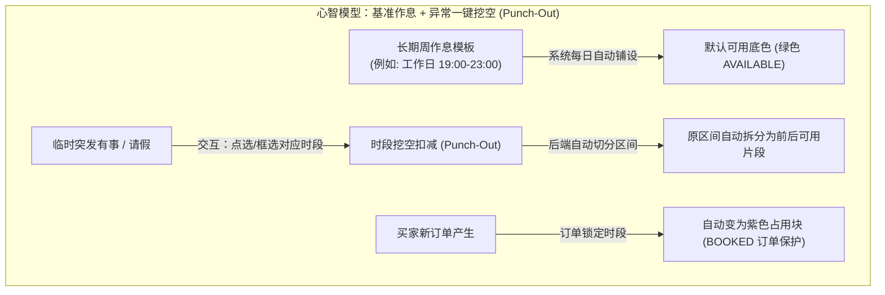

# 陪玩端档期管理重构与周日程看板设计方案

> 文档类型：陪玩端业务重构与交互升级设计方案  
> 编制日期：2026-10-17  
> 关联对话：[陪玩端档期管理页面重新设计](conversation://ecbe4e95-5271-4ffc-a874-6e7097176b3b)  
> 实施状态：**后端核心与接口已完成验证，前端网格组件待适配**  
> 适用项目：游戏陪玩系统（毕业设计项目）  
> 对应模块：陪玩端档期管理（FR-P10 / Availability Management）  

---

## 1. 概述与核心结论

### 1.1 业务背景
在游戏陪玩平台中，档期管理是陪玩师（服务提供者）与买家（服务消费者）之间的核心履约纽带。陪玩师需要高频、便捷地配置自己在各天的空闲时间以供买家预约。
原有档期管理页面在实际使用过程中存在严重的“反人类”交互痛点和后端逻辑死锁，导致陪玩师设置“什么时候临时没空”极其繁琐，严重影响入驻体验和接单效率。

### 1.2 核心诊断与重构结论

| 维度 | 原有系统问题（痛点根因） | 本次重构设计方案 | 带来的体验与工程价值 |
| :--- | :--- | :--- | :--- |
| **底层逻辑** | **逻辑死锁（代码级缺陷）**：在已有可约时段内点击“设置不可约”时，后端直接判定为“与已有档期重叠（`SLOT_CONFLICT`）”并拦截抛错，导致陪玩师想请假 1 小时必须先删整天再重新分段录入。 | **引入区间挖空扣减（Punch-Out）算法**：在已有可用区间内设置不可约时，后端自动执行区间差集裁剪与切分（中间切穿拆为两段、掐头去尾保留剩余段）。 | 彻底终结“设没空报重叠”的逻辑死锁，不可约设置即点即生效。 |
| **状态感知** | **订单占用时段完全盲区**：周视图仅展示档期配置，完全不展示已被买家下单的时间段。陪玩师无法预知哪些时段已有订单，删除档期时频频触发系统拦截报错。 | **三态聚合看板**：全景聚合接口（`overview`）联查有效订单（`PlayOrder`），在一张看板上透明呈现 **“可约（绿色）/ 已锁定有单（紫色）/ 休息没空（灰色）”**。 | 所见即所得，避免陪玩师误删有单档期，订单分布一目了然。 |
| **交互范式** | **低密度文本卡片 + 频繁弹窗表单**：使用 7 张离散卡片展示文本列表（如 `[可约] [模板] 19:00-23:00`），每次调时间都要经历弹窗、日期选择器、时间选择器的多步折磨。 | **24 小时周日程时间网格（Weekly Time Grid）**：采用 Google Calendar / Airbnb 风格的周时间矩阵，支持在网格上**直接点击/涂抹切换“有空/没空”**，提供“今日一键休息”与“整天休息”快捷兜底。 | 操作路径从 4 步表单弹窗精简至 1 步点击涂抹，交互效率提升数倍。 |
| **作息心智** | 手工重复计算每天的时间加减法。 | **“周基准模板 + 异常一键挖空”**：以长期周期模板自动铺设底色，日常仅需处理突发请假或加班。 | 符合真实作息规律，极大幅度降低日常维护心智负担。 |

---

## 2. 现状深度诊断：为什么原有设计“反人类”？

经对 [ScheduleView.vue](file:///d:/bishe/游戏陪玩系统/frontend/src/views/companion/ScheduleView.vue) 与后端 [AvailabilityService.java](file:///d:/bishe/游戏陪玩系统/backend/src/main/java/com/gameplay/companion/service/AvailabilityService.java) 的源码审查，原有实现存在以下四大痛点：

### 2.1 痛点一：核心致命缺陷——“设没空”报时间重叠（已验证）
- **现象**：陪玩师已配置长期模板（如周一至周五 19:00~23:00 可约）。周三晚 20:00~21:00 突发有事，点击【设置临时不可约】，选择 20:00~21:00，提交后系统直接弹窗报错：
  ```text
  与已有档期时间重叠
  ```
- **根因分析**：后端的 `checkConflicts` 方法无差别地检查了待插入记录与已有所有记录的重叠。把“设没空”当作新增一个独立的互斥区间，而没有理解陪玩师的真实意图是**在已有可约区间上抠除 1 小时**。导致陪玩师必须手动把 19:00~23:00 拆成 19:00~20:00 和 21:00~23:00 两条重新录入。

### 2.2 痛点二：“默认不可约”体系下孤立的 UNAVAILABLE 记录毫无意义（已验证）
- 在订单服务 [OrderService.java](file:///d:/bishe/游戏陪玩系统/backend/src/main/java/com/gameplay/companion/service/OrderService.java) 中，买家下单校验规则是：**预约区间必须完全被陪玩师的 AVAILABLE 档期覆盖**。
- 未配置 AVAILABLE 的时间段买家本来就无法下单；而配置了 AVAILABLE 的时段又无法插入 UNAVAILABLE。因此，原有数据库中的 `UNAVAILABLE` 记录成为了“写不进去、读了也无用”的逻辑死代码。

### 2.3 痛点三：缺乏已被订单占用的时间感知（已验证）
- 周视图接口仅返回 `listAvailabilities`，完全没有关联买家已经预约成功的待履约或服务中订单。
- 陪玩师在临时调整或删除档期时，若恰好撞上订单，后端会直接报错 `AVAILABILITY_DELETE_FORBIDDEN`，但在界面上陪玩师根本看不到订单分布在哪几点。

### 2.4 痛点四：纯文本卡片列表展示，信息密度低、操作路径长
- 页面仅按周一到周日展示 7 张卡片，卡片内部堆叠纯文本标签。
- 陪玩师无法一目了然看出今天全天还剩几个小时可接单，每一次修改都必须经过 Modal 弹窗 + 日期选择器 + 时间选择器的多层操作。

---

## 3. 核心心智模型与架构思路



### 核心设计哲学
1. **不要让用户手动算时间加减法**：陪玩师只需声明“这 1 个小时我没空”，系统自动在底层完成区间的差集分割（Split）。
2. **可视化时间矩阵（Time Grid）**：将周一至周日映射为 24 小时网格，所见即所得。
3. **三态透明化与订单防穿透**：
   - 🟢 **可约（Free / Available）**：买家可在该时段下单。
   - 🟣 **有单（Booked）**：已有待服务/服务中订单锁定，悬浮显示买家与订单简讯，不可直接取消。
   - ⚪ **休息/没空（Off / Unavailable）**：空白或灰色斜线网格，不可下单。

---

## 4. 全新界面布局设计（UI / UX 蓝图）

整个页面由三大板块构成：**顶部效率工具栏**、**核心周日程网格（Weekly Time Grid）**、**长期作息模板抽屉**。

```
+----------------------------------------------------------------------------------------------------+
| ⚡ 顶部工具栏                                                                                      |
| [ 今日在线 🟢/一键休息 ⚪ ]   ‹ 上一周   [ 2026-10-12 ~ 2026-10-18 (第42周) ]   下一周 ›   [回到今天] |
| 图例: [🟢 可约 (36h)] [🟣 订单锁定 (8h)] [⚪ 休息 (124h)]   | 笔刷工具: (•) 设为可约  ( ) 设为没空       |
+----------------------------------------------------------------------------------------------------+
| 时间  | 周一 10-12   | 周二 10-13   | 周三 10-14   | 周四 10-15   | 周五 10-16   | 周六 10-17   | 周日 10-18   |
|       | [整天休息]   | [整天休息]   | [整天休息]   | [整天休息]   | [整天休息]   | [整天休息]   | [整天休息]   |
+-------+--------------+--------------+--------------+--------------+--------------+--------------+--------------+
| 09:00 |              |              |              |              |              | 🟢 可约      | 🟢 可约      |
| 10:00 |              |              |              |              |              | 🟢 可约      | 🟢 可约      |
| ...   |              |              |              |              |              | 🟣 [王者-张三] | 🟢 可约     |
| 19:00 | 🟢 可约      | 🟢 可约      | 🟢 可约      | 🟢 可约      | 🟢 可约      | 🟢 可约      | 🟢 可约      |
| 20:00 | 🟢 可约      | 🟢 可约      | ⚪ [临时有事] | 🟢 可约      | 🟣 [LOL-李四] | 🟢 可约      | 🟢 可约      |
| 21:00 | 🟢 可约      | 🟢 可约      | 🟢 可约      | 🟢 可约      | 🟣 [LOL-李四] | 🟢 可约      | 🟢 可约      |
| 22:00 | 🟢 可约      | 🟢 可约      | 🟢 可约      | 🟢 可约      | 🟢 可约      | 🟢 可约      | 🟢 可约      |
+----------------------------------------------------------------------------------------------------+
| ⚙️ 底部/抽屉: 长期周作息模板 (工作日 19:00-23:00，周末 10:00-24:00，自动续期未来 28 天)            |
+----------------------------------------------------------------------------------------------------+
```

### 4.1 顶部效率工具栏
1. **今日接单总开关（快捷兜底）**：
   - 放置醒目的 `今日在线 / 今日一键休息` 切换 Toggle。突发生病、断网或外出时，一键即可将今天剩余可用档期全部设为休息，无需逐小时调整。
2. **周导航控制器**：
   - 提供 `‹ 上一周`、`本周 / 回到今天`、`下一周 ›`，并标注当前日期范围与对应周数。
3. **图例与笔刷工具**：
   - 展示统计数字：本周累计可约时长、订单锁定总时长；
   - 笔刷模式切换：选中 `[设为没空]` 后，点击或拖拽网格即可将格子变灰。

### 4.2 核心看板：24 小时周日程网格（Weekly Time Grid）
1. **表头快捷操作**：
   - 每一列对应一天，提供 `[全天休息]` 与 `[设为全天有空]` 按钮，一键覆盖单日状态。
2. **直观拖拽与涂抹交互**：
   - 支持鼠标单击切换单个 1 小时格子的状态；
   - 支持按住鼠标在同一列中垂直划动，批量将连续几个小时设为“可约”或“休息”；
3. **订单卡片浮层与保护机制**：
   - 已被订单锁定的时段以紫色高亮渲染，显示买家昵称、游戏名和起止时间；
   - 悬浮显示气泡卡片（订单编号、服务时长、订单状态等）；
   - 针对订单占用格，禁止直接点击设为休息，保护买家履约确定性。
4. **精细微调（微型 Popover）**：
   - 针对非整点时段（如 19:30~21:00），点击该可用块呼出 Popover，支持微调起止分钟或输入不可约请假备注。

---

## 5. 后端底层核心算法与架构设计

### 5.1 核心算法：区间挖空扣减（Interval Punch-Out）
当陪玩师在某时间区间 $[T_{punchStart}, T_{punchEnd}]$ 设置不可约时，系统自动检索出所有有重叠的可用记录（`overlaps`），按几何包含关系执行切分：

```
Case 1: 完全覆盖 (Subsumed)
原区间:      |========|
挖空范围:  |============|
处理结果:  原区间直接物理删除

Case 2: 中间切穿 (Split)
原区间:    |====================|
挖空范围:        |========|
处理结果:  原区间缩短为 [start, punchStart]，新增后半段 [punchEnd, end]

Case 3: 右部重叠 (Left Over)
原区间:    |============|
挖空范围:        |============|
处理结果:  原区间终点前移，更新为 [start, punchStart]

Case 4: 左部重叠 (Right Over)
原区间:          |============|
挖空范围:  |============|
处理结果:  原区间起点后移，更新为 [punchEnd, end]
```

同理，当在已有不可约时段上重新划定“设为有空”时，执行对等的反向切分，确保底层数据始终互斥、无缝且精确。

### 5.2 订单防冲突安全屏障
在执行挖空或删除操作前，先执行订单安全校验：
```java
LambdaQueryWrapper<PlayOrder> orderWrapper = new LambdaQueryWrapper<PlayOrder>()
        .eq(PlayOrder::getCompanionUserId, userId)
        .in(PlayOrder::getOrderStatus, "WAITING_ACCEPTANCE", "WAITING_SERVICE", "IN_SERVICE", "WAITING_CONFIRMATION")
        .lt(PlayOrder::getAppointmentStartAt, punchEnd)
        .gt(PlayOrder::getAppointmentEndAt, punchStart);
```
若命中正在履约的订单，系统抛出 `AVAILABILITY_DELETE_FORBIDDEN`，提示陪玩师必须先通过协商取消或退款才能关闭该档期。

---

## 6. 接口与数据模型规范

### 6.1 新增/增强接口清单

| 请求方式 | 接口端点路径 | 功能描述 | 核心入参 / 返回模型 |
| :--- | :--- | :--- | :--- |
| `GET` | `/api/companion/availabilities/overview` | **周日程全景概览**：聚合当前范围内的可用档期及被订单锁定的时段明细 | 入参：`startAt`, `endAt`<br/>返回：`ScheduleOverviewView` |
| `POST` | `/api/companion/availabilities/toggle-day-off` | **一键整天状态切换**：快速将指定日期设为全天休息或全天可约 | 入参：`ToggleDayOffRequest(date, isOff, remark)` |
| `POST` | `/api/companion/availabilities/unavailable` | **时段挖空请假**：在已有档期中扣除不可约时段，自动切分区间 | 入参：`AvailabilityCreateRequest(startAt, endAt, remark)` |

### 6.2 报文契约定义

#### 1. 全景概览响应模型 (`ScheduleOverviewView`)
```json
{
  "code": 200,
  "message": "success",
  "data": {
    "availabilities": [
      {
        "id": 101,
        "companionUserId": 5,
        "startAt": "2026-10-14 10:00:00",
        "endAt": "2026-10-14 14:00:00",
        "availabilityStatus": "AVAILABLE",
        "sourceType": "RECURRENCE",
        "templateId": 1,
        "remark": "工作日模板"
      },
      {
        "id": 102,
        "companionUserId": 5,
        "startAt": "2026-10-14 16:00:00",
        "endAt": "2026-10-14 22:00:00",
        "availabilityStatus": "AVAILABLE",
        "sourceType": "MANUAL",
        "templateId": 0,
        "remark": ""
      }
    ],
    "bookedSlots": [
      {
        "orderId": 2048,
        "orderNo": "ORD202610140001",
        "companionUserId": 5,
        "customerUserId": 12,
        "customerNickname": "上分小达人",
        "serviceTitle": "王者荣耀-排位上分",
        "gameServer": "微信区",
        "gameNickname": "打野超凶",
        "startAt": "2026-10-14 19:30:00",
        "endAt": "2026-10-14 21:30:00",
        "orderStatus": "WAITING_SERVICE"
      }
    ]
  }
}
```

#### 2. 一键整天切换请求模型 (`ToggleDayOffRequest`)
```json
{
  "date": "2026-10-14",
  "isOff": true,
  "remark": "全天外出体检"
}
```

---

## 7. 落地进展与验证状态

### 7.1 后端代码实施（已完成，已验证）
- [x] **Controller 改造**：在 [CompanionAvailabilityController.java](file:///d:/bishe/游戏陪玩系统/backend/src/main/java/com/gameplay/companion/controller/CompanionAvailabilityController.java) 中新增 `/overview` 与 `/toggle-day-off` 端点；
- [x] **Service 算法实现**：在 [AvailabilityService.java](file:///d:/bishe/游戏陪玩系统/backend/src/main/java/com/gameplay/companion/service/AvailabilityService.java) 中编写 `punchOutAvailableSlots` 与 `punchOutUnavailableSlots` 双向区间挖空算法，改造 `createUnavailable` 避免死锁，并实现 `getScheduleOverview` 联查订单视图与买家昵称映射；
- [x] **DTO 新增**：新增 [ScheduleOverviewView.java](file:///d:/bishe/游戏陪玩系统/backend/src/main/java/com/gameplay/companion/dto/ScheduleOverviewView.java) 与 [BookedSlotView.java](file:///d:/bishe/游戏陪玩系统/backend/src/main/java/com/gameplay/companion/dto/BookedSlotView.java)；
- [x] **单元与集成测试验证**：在 [CompanionModuleTest.java](file:///d:/bishe/游戏陪玩系统/backend/src/test/java/com/gameplay/companion/CompanionModuleTest.java) 中添加端到端测试用例 `availability_punch_out_and_overview_flow`，完整测试了：
  1. 创建 10:00~22:00 可约档期；
  2. 中间挖空 14:00~16:00 设为没空；
  3. 自动切分为 3 条记录（10~14 可用、16~22 可用、14~16 不可用）；
  4. 概览接口正确聚合订单与档期；
  5. 一键全天休息切换生效。
  测试执行结果：**BUILD SUCCESS**。

### 7.2 前端代码实施状态
- [x] **API 契约层封装**：在 [frontend/src/api/companion.ts](file:///d:/bishe/游戏陪玩系统/frontend/src/api/companion.ts) 中新增 `getScheduleOverview` 与 `toggleDayOff` 方法；
- [ ] **UI 页面重构**：将 [ScheduleView.vue](file:///d:/bishe/游戏陪玩系统/frontend/src/views/companion/ScheduleView.vue) 从原有的 7 张文本卡片升级为 24 小时周时间网格（Weekly Time Grid），接入 overview 接口并实现一键休息与涂抹笔刷交互（待前端开发落地）。

---

## 8. 软件工程与毕业设计价值总结

1. **业务连续性与防退化设计**：重构方案无缝兼容原有的长期周期模板（`template_id`）与买家端区间预约判定逻辑（`OrderService`），不需要调整数据库核心表结构或迁移既有订单历史。
2. **严密的区间几何算法应用**：在后端服务层抽象出通用的一维时段集合差集（Punch-out）算法，妥善处理了全覆盖、内含切穿、左侧截断、右侧截断四种拓扑场景，是毕业设计答辩中可圈可点的算法亮点。
3. **真实生产级业务状态机闭环**：通过融合订单履约态（待接单、待服务、服务中）与档期可用态，形成“可用 - 已订 - 休息”完整状态闭环，并设置了订单防删除保护屏障，体现了严谨的工程思维与鲁棒性。
